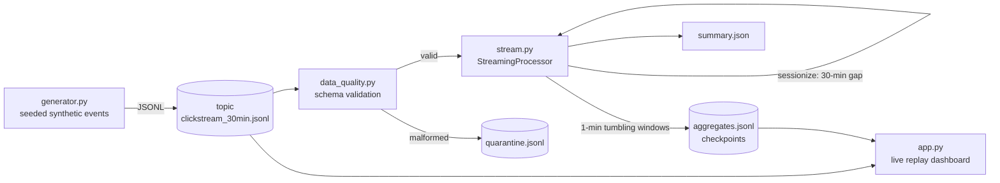

# Real-time Clickstream Analytics Pipeline


A real-time clickstream analytics pipeline for e-commerce, built end to end
without any external services: a deterministic seeded event generator feeds a
JSONL "topic" that emulates Kafka; a stateful streaming processor maintains
1-minute tumbling windows, derives user sessions, and enforces a watermark
plus dedupe and schema validation; a Streamlit dashboard replays the stream
live.

**Live demo:** https://realtime-clickstream-pipeline.streamlit.app

## Architecture



## Features

- **Seeded synthetic generator** — `page_view`, `search`, `add_to_cart`,
  `purchase` events with funnel-coherent user sessions; byte-identical
  output for a given seed
- **Real-world messiness injected** — duplicate `event_id`s, out-of-order
  delivery, late events, and malformed rows
- **Streaming processor** — 1-minute tumbling windows with events,
  unique users, revenue, and the view → cart → purchase funnel
- **Sessionization** — a new session starts after a 30-minute gap per user
- **Watermark** — events more than 5 minutes behind the max seen timestamp
  are dropped as late
- **Dedupe** — exact-once per `event_id` within the run
- **Data quality** — schema validation with quarantine file and counters
  (duplicates dropped, late dropped, malformed quarantined)
- **Checkpoints** — closed windows appended to `out/aggregates.jsonl` as
  the watermark passes; final `out/summary.json`
- **Live dashboard** — Streamlit replay mode (adjustable speed, KPIs,
  events/sec, revenue/min, funnel, top pages/products) plus an offline
  mode over the checkpoints

## Quickstart

```bash
pip install -r requirements.txt

# 1. generate the demo topic (~4k events, 30 simulated minutes, deterministic)
python data/make_demo.py

# 2. run the streaming pipeline (replay-speed 0 = as fast as possible)
PYTHONPATH=src python -m clickstream.stream \
    --topic data/clickstream_30min.jsonl --out out --replay-speed 0

# 3. run the tests
PYTHONPATH=src pytest -q

# 4. launch the dashboard (live replay + offline modes)
streamlit run app.py
```

Generate a bigger local topic (e.g. 50k events) with:

```bash
python data/make_demo.py --n 50000 --out /tmp/clickstream_50k.jsonl
```

## Project structure

```
realtime-clickstream-pipeline/
├── app.py                    # Streamlit dashboard (live replay + offline)
├── data/
│   └── make_demo.py          # builds data/clickstream_30min.jsonl (seeded)
├── src/clickstream/
│   ├── generator.py          # synthetic event generator (CLI: --n --seed --out --minutes)
│   ├── stream.py             # streaming processor: windows, sessions, watermark (CLI)
│   └── data_quality.py       # schema validation, quarantine, quality counters
├── tests/
│   ├── test_generator.py     # determinism (same seed -> same bytes)
│   ├── test_stream.py        # dedupe, watermark, sessionization, funnel math
│   └── test_data_quality.py  # schema validation rules
├── requirements.txt
├── Dockerfile
└── README.md
```

## Production extensions

What this demo stands in for, and how it would harden for production:

- **Real Kafka** — replace the JSONL topic with a Kafka topic; the
  generator becomes a Kafka producer, the processor a consumer group with
  offset commits
- **Flink / Spark Structured Streaming** — move windowed aggregations to a
  distributed engine for horizontal scale and exactly-once semantics
- **Exactly-once sinks** — checkpoint window state and write aggregates
  transactionally (idempotent keys on `window_start`) instead of plain appends
- **Schema registry** — Avro/Protobuf schemas with compatibility checks
  instead of ad-hoc dict validation
- **Partitioning** — partition the topic by `user_id` so sessionization is
  embarrassingly parallel and ordering holds per key
- **Durable state** — back session and window state with RocksDB / a
  changelog topic so restarts don't lose in-flight windows
- **Late-data policy** — allowed lateness + side outputs (instead of a hard
  drop) so late revenue still lands in a corrections stream
